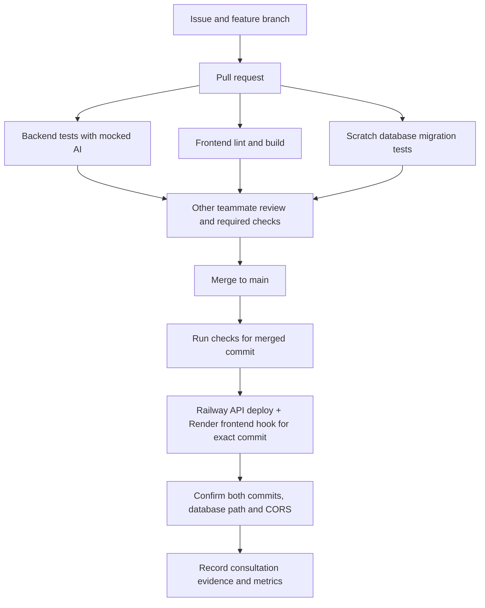

# TekaTech delivery pipeline

Owner: project owner (you), the team's one DevOps Engineer and an additional full-stack contributor. Configuration: [.github/workflows/ci.yml](.github/workflows/ci.yml) and [render.yaml](render.yaml).

## Triggers and stages

Every pull request runs all three independent quality jobs. Pushes to main run the same jobs and then deploy; manual workflow dispatch runs checks without deploying. PR jobs have read-only repository permissions, dummy configuration and no live AI calls or deployment credentials.

| Job | Stages | Purpose |
| --- | --- | --- |
| Backend tests | tracked-file secret scan; full-history secret scan (gitleaks 8.30.1, checksum-verified, redacted, all branches); workflow lint (actionlint 1.7.12, checksum-verified, with the runner's shellcheck); uv dependency install from lock; source compile; pytest; app import check | Reject leaked credentials and broken workflow syntax/expressions/shell first (cheap checks fail fast), then verify API logic, authorization, input limits and AI behavior using fakes/mocks |
| Frontend lint and build | cached Node/npm install; ESLint; Vitest unit tests (`npm test`, jsdom, `src/**/*.test.{js,jsx}`); Vite production build; short-lived build artifact | Reject invalid code, check UI logic (answer states, citations, follow-ups, form validation) and prove the UI compiles |
| Browser checks (failure drill) | cached Node/npm install; Playwright Chromium; `npm run test:e2e` against a faked API (fake `*.e2e.test` addresses, no secrets); report artifact on failure | The ask and compare journeys show the safe message for each failure-drill mode and recover (#119, #128). Runs on every PR and main push, but isn't a deploy dependency |
| Database migrations | scratch pgvector/Postgres (runner-image `psql`, no apt install); roles; apply SQL twice; reconcile legacy RPC; verify vector in public; transactional acceptance checks | Prove reproducible setup, replay safety, retrieval, relationships and access grants without touching production |
| Main guard (reviewed PR required) | pushes to main only: the commit must come from a merged PR approved by another teammate on its final commit | Free-plan substitute for branch protection: a direct push or unreviewed merge cannot deploy, and a `process` issue is opened automatically |
| Deploy main after checks | gated on all three jobs and the main guard; deploy the tested SHA's API to Railway (`railway up`) and POST the secret Render frontend hook; poll public deployment smoke checks | Deploy only checked main commits; production secrets are injected by the host |



**Team engineering workflow diagram:** [docs/devops/engineering-workflow.html](docs/devops/engineering-workflow.html) (download and open in a browser) shows the whole path from issue to verified release: which steps run automatically in GitHub Actions, which are assisted Claude Code skills (`/review-deliverable`, `/pr-gate`, `/verify-deploy`, `/incident`, `/log-work`, `/pipeline-metrics`, `/consultation-packet`), and which need a human (teammate review, merge). Its editable source is `docs/devops/engineering-workflow.archify.json`, rendered with the archify skill.

Deployment does not migrate the real Supabase database automatically. Apply compatible tracked SQL first as described in the runbook. `/health` is liveness only (Railway's health check path, set in `.railway/railway.ts`; no database call, so a database blip cannot make the host restart the API) and does not prove database readiness. `/health/ready` adds one cheap database read (`gadgets`, one row, 5 s timeout) and answers 200 `{status, database: "ok", latency_ms}` or 503 with `database: "error"` and no error details; it is rate limited to 30/minute per client. A successful hook request only proves a deploy was requested; confirm deploy completion and browser/API behavior before Done.

## Scheduled operations

Read-only workflows that run from `main` on a schedule (GitHub may start them late) and can also be run from the Actions tab. They make no AI calls and never deploy.

| Workflow | When | What it does | On failure |
| --- | --- | --- | --- |
| `ops-health.yml` — Production smoke | Daily 08:00 Asia/Manila | `deployed_smoke.py` against production for the latest `main` commit: liveness, `/health/ready` database readiness (reported `skipped` on releases that predate it), both hosts' version, database-backed `/gadgets`, CORS, frontend shell; retries cover a fresh deploy that is still starting | Opens one `incident` issue (or comments on the open one) with the run link; recovery is recorded in `docs/devops/incidents.md` |
| `ops-weekly.yml` — Delivery metrics | Saturday 09:00 Asia/Manila | `scripts/pipeline_metrics.py` for the last 7 days into the run summary plus a 30-day JSON artifact | Job fails visibly; values with no runs stay N/A |
| `ops-weekly.yml` — Dependency audit | Saturday 09:00 Asia/Manila | `pip-audit 2.10.1` on backend runtime dependencies (from `uv.lock`) and `npm audit --omit=dev --audit-level=high` on the frontend | Job fails visibly; fixes go through reviewed PRs, never forced upgrades |
| `ops-ai-smoke.yml` — Live AI smoke | Friday 08:30 Asia/Manila, plus manual dispatch | `scripts/ai_smoke.py`: one `text-embedding-3-small` request and one `gpt-5-mini` chat request capped at 300 output tokens, 20 s timeout, no retries, using the dedicated `OPENAI_SMOKE_API_KEY` secret (never the production key); records model, latency, tokens and request ids, never the key or the reply text. Never a required check and never on PRs, so a provider outage cannot block merges or deploys. Skips with a warning if the secret is unset | Opens one `area:backend` issue for Manuel (or comments on the open one) with the run link and the provider error code |
| `prompt-eval.yml` — Offline prompt evaluation | PRs that change `prompts/**`, `backend/prompts.py`, `backend/citations.py` or `scripts/eval_runner.py`; manual dispatch | Adrian's `scripts/eval_runner.py` on `prompts/eval/reference_answers.json` and any recorded answers in `prompts/eval/answers/*.json`, labeled with `PROMPT_VERSION` from `backend/prompts.py`; JSON + Markdown reports in the run summary and a 30-day artifact. No model calls, no secrets | Job fails when a target is missed (exit 1) and the summary shows which cases failed; not a deploy dependency. Live `/query` scoring stays out of CI on purpose (paid, needs a running API): run it by hand with `scripts/eval_adapter.py`, bounded and against TekaTech-dev (latest: `docs/evidence/eval-s4-2026-10-28-main.md`, #151) |

## Automated PR review and repository guardrails

| Control | Where | Effect |
| --- | --- | --- |
| PR policy | `pr-review.yml` | Fails when a PR links no issue/task, changes `backend/sql/` without manual-migration instructions, or includes a `.env` file; warns on PRs over 600 changed lines and on CI/hosting/secret-check changes not authored by DevOps |
| Python review | `pr-review.yml`, steps in the same "PR policy" job (skipped when only the PR description was edited) | `ruff 0.16.10` bug and security rules (`E4,E7,E9,F,B,S`; ignores FastAPI `B008` and test `S101`) as inline annotations; non-blocking hints for author and reviewer |
| Owner-area labels and reviewer assignment | `labeler.yml`, one job (`pull_request_target`, no PR code executed) | Syncs owner-area labels on every push; requests the reviewer from the team review table when the PR is opened, reopened or marked ready; works for fork PRs |
| Repository settings (applied 2026-10-17) | GitHub settings | Squash merge only; head branches deleted after merge; Dependabot alerts and security-fix PRs on; Actions limited to GitHub-owned actions plus `astral-sh/setup-uv`; fork PR workflows run with read-only token and no secrets; workflows cannot approve PRs |

Automated review supports, and never replaces, the required teammate approval.

## Configuration and quality gates

Set GitHub repository Actions secrets `RAILWAY_TOKEN` (Railway project token for the `production` environment) and `RENDER_FRONTEND_DEPLOY_HOOK`, and repository Actions variables `PRODUCTION_API_URL` and `PRODUCTION_FRONTEND_URL`. Since 12 Nov 2026 the deploy job sends the backend to Railway with the pinned CLI (`railway variable set APP_COMMIT=<sha>`, then `railway up backend --path-as-root --ci`; `/version` reports `APP_COMMIT`) and the frontend to Render with its hook. The old Render API and its `RENDER_BACKEND_DEPLOY_HOOK` secret were retired on 13 Nov 2026. Railway service settings live in `.railway/railway.ts` (applied by hand with `railway config apply`; see `.railway/README.md`). Railway's GitHub autodeploy stays off (its Wait-for-CI would deadlock with the smoke step; [railway-migration-plan.md](docs/devops/railway-migration-plan.md) section 4). This private repository uses GitHub Free; environment secrets for private repositories require an eligible paid plan. The deploy job references the production hooks only on pushes to main and after all three checks pass; PR check jobs are not given those hook variables. Missing hooks or URL variables fail the deployment job explicitly. The smoke stage waits for both exact commits, `/health/ready` database readiness, database-backed `/gadgets`, the frontend shell and allowed CORS, then uploads its result as evidence. Readiness is `passed`, or `skipped` when the deployed release predates `/health/ready` (404), so rollback rehearsals of older releases still pass; a 503 fails the smoke. Every API response carries an `X-Request-ID` header (a caller's plain value of up to 64 `[A-Za-z0-9_-]` characters is reused, otherwise a uuid4 hex), and the API logs one line per request with method, path without query string, status, duration, request id, Render's `Rndr-Id` (empty on Railway) and the number of `X-Forwarded-For` entries; bodies, auth headers and query strings are never logged. Unhandled errors return a JSON 500 naming only the request id. No paid AI calls occur in deployment smoke tests. Keep automatic hosting deploys off so the Actions pipeline is the deploy trigger. Set production API configuration in Railway and frontend configuration in Render, never in code. If adding preview/staging environments, use separate service credentials and hook names.

Workflow supply chain (13 Nov 2026, branch `tekatech/s5-ik-ci-supply-chain`): every `uses:` is pinned to a full commit SHA with a `# vX.Y.Z` comment, and the Dependabot `github-actions` entry bumps SHA and comment together. `actions/checkout` runs with `persist-credentials: false` everywhere (no workflow pushes with the checkout token; `release.yml` uses `GH_TOKEN` for `gh release create`). In the `ci.yml` deploy job and `rollback.yml`, `RAILWAY_TOKEN` and `RENDER_FRONTEND_DEPLOY_HOOK` are step-scoped: only the configuration check, the hook trigger and the `railway` deploy step receive them. The Railway CLI (5.71.0) is installed from the `railway-v5.71.0-x86_64-unknown-linux-musl.tar.gz` release asset with a pinned SHA-256 (same pattern as gitleaks/actionlint), not `npm install -g @railway/cli`, whose postinstall script downloads that binary at install time; bump version and checksum in both workflows together.

Protect main: one other teammate review, dismiss stale approvals, required `Backend tests`, `Frontend lint and build`, `Database migrations` statuses, no force pushes, no routine direct commits. The repository is connected, but GitHub returned HTTP 403 requiring Pro or public visibility for branch protection on this private repository. Those controls are not enabled; rulesets return the same 403 (checked 2026-10-17). Reviewed PRs are still the team policy, and the **main guard** job enforces it at deployment time: it cannot prevent a push to main, but a commit without a merged, teammate-approved PR is not deployed and opens a `process` issue (verified against history: allows `68b4c5a`/PR #16, blocks direct push `ed37f45` and unreviewed PR #15 merge `53f62e9`). The owner requested merging Sprint 1 PR #15 after passing checks; record that exception honestly because owner authorization does not satisfy the course's other-teammate review requirement. Resolve plan/visibility with the team before claiming an enforced gate.

**Status 15 Nov 2026 (rechecked for the final video; owner decision: keep this setup).**
- **Still unavailable.** GitHub returns HTTP 403 "Upgrade to GitHub Pro or make this repository public to enable this feature." for all three of: branch protection (`/branches/main/protection`), rulesets (`/rulesets`) and branch rules (`/rules/branches/main`).
- **Why the repo was not made public.** A full-history scan is clean (gitleaks 8.30.1, 667 commits, `--all`, no leaks; the tracked-file guard also passed). But publishing would expose every member's commit email (personal and school addresses), and that cannot be undone without rewriting history.
- **Why not Pro.** GitHub Pro (paid, or free via the Student Developer Pack) was not taken before the deadline.
- **What enforces the rules, all in the repository:**

  | Rule | Where | Effect |
  | --- | --- | --- |
  | Reviewed PR, teammate approval on the **final** commit (stale approvals don't count) | `ci.yml` job `main-guard` | Runs on every push to main; `deploy` `needs` it, so an unreviewed change never reaches production. It opens a `process` issue |
  | Required checks pass before deploy | `ci.yml` `deploy.needs: [backend, frontend, database, main-guard]` | Any failing check skips the deploy |
  | Issue/task linked, no `.env`, SQL changes carry instructions, pipeline changes flagged | `pr-review.yml` job `PR policy` | Fails the PR check |
  | Secrets never committed | `scripts/check_secrets.py` + gitleaks full-history scan in `Backend tests` | Fails CI |
  | Workflow files valid | actionlint + shellcheck in `Backend tests` | Fails CI |
  | Reviewer requested by area | `labeler.yml` | Automatic review request |

- **Evidence that the guard works.** It has blocked an unreviewed change four times, each with an automatic issue: [#63](https://github.com/Ikeee-AI/TekaTech/issues/63) (`28132c9`), [#144](https://github.com/Ikeee-AI/TekaTech/issues/144) (`ab785a8`), [#251](https://github.com/Ikeee-AI/TekaTech/issues/251) (`f836e3b`) and [#268](https://github.com/Ikeee-AI/TekaTech/issues/268) (`b84a2bc`).
  - In the most recent case, PR #254 was merged with its approval on an older commit. Run [43607550071](https://github.com/Ikeee-AI/TekaTech/actions/runs/43607550071) failed at the main guard, the deploy was skipped, and production stayed on `9704823`.
  - The code went live only with the next reviewed PR (#269, run [43610686214](https://github.com/Ikeee-AI/TekaTech/actions/runs/43610686214)).
- **The honest limit.** GitHub's Merge button is not disabled for unreviewed PRs. The gate is at deployment, not at merge.

Dependency caching and parallel jobs are enabled. Older PR runs on the same ref are cancelled for fast feedback. Main runs are serialized and not cancelled in progress; if several merges queue up, GitHub concurrency keeps the latest pending run. This coalesces superseded pending commits while ensuring the latest main state reaches production. Record that behavior when measuring throughput. Use separate staging credentials before adding preview deployments; never point previews at writable production data by accident.

## Manual release workflows

| Workflow | Trigger | Purpose |
| --- | --- | --- |
| `rollback.yml` — Rollback production | Actions tab, inputs: full SHA + reason | Redeploy a known-good main commit that passed all three checks (API to Railway, frontend to Render), then smoke-test it. Main must then be reconciled with a reviewed revert PR (see runbook). |
| `release.yml` — Release notes | Push a `v*` tag on a main commit | Create a GitHub Release with generated notes; does not deploy. |

### Live deploy challenge timer

The Demo Day challenge (small visible change → reviewed PR → merge → automatic deploy, within 30 minutes) is timed from GitHub records, not a stopwatch:

```bash
python scripts/deploy_challenge_timer.py --pr <n> --start 2026-11-02T19:30:00+08:00 --wait --smoke --report .local/deploy-challenge.json
```

It prints each stage as minutes since the start: first commit, PR opened, the three required checks green on the final commit, a teammate's approval on that commit, merged, deploy job finished, and (with `--smoke`) `deployed_smoke.py` passing on the merge commit. `--start` must include a time zone (`+08:00` for Manila, or `Z`). `--wait` polls every 20 s while the presenter narrates. It is read-only and exits 1 if the 30-minute target is missed. Run without `--wait` afterwards to reproduce the evidence for any merged PR.

## Measurement and evidence

Update [metrics](docs/devops/metrics.md), [optimizations](docs/devops/optimizations.md) and [incidents](docs/devops/incidents.md) before each consultation. Keep real run links, commit SHAs and timestamps. The [first hosted PR run](https://github.com/Ikeee-AI/TekaTech/actions/runs/38167468464) passed all three quality jobs in 40 seconds; deployment correctly skipped for the PR. The metrics log records this initial baseline and its cutoff. Local command time must not be reported as CI pipeline time.

Official configuration references: [GitHub Postgres service containers](https://docs.github.com/en/actions/tutorials/use-containerized-services/create-postgresql-service-containers), [Render Blueprint specification](https://render.com/docs/blueprint-spec), and [Render deploy hooks](https://render.com/docs/deploy-hooks).
