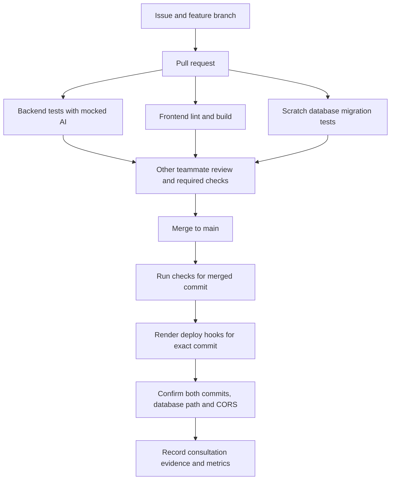

# TekaTech delivery pipeline

Owner: project owner (you), the team's one DevOps Engineer and an additional full-stack contributor. Configuration: [.github/workflows/ci.yml](.github/workflows/ci.yml) and [render.yaml](render.yaml).

## Triggers and stages

Every pull request runs all three independent quality jobs. Pushes to main run the same jobs and then deploy; manual workflow dispatch runs checks without deploying. PR jobs have read-only repository permissions, dummy configuration and no live AI calls or deployment credentials.

| Job | Stages | Purpose |
| --- | --- | --- |
| Backend tests | tracked-file secret scan; full-history secret scan (gitleaks 8.30.1, checksum-verified, redacted, all branches); workflow lint (actionlint 1.7.12, checksum-verified, with the runner's shellcheck); uv dependency install from lock; source compile; pytest; app import check | Reject leaked credentials and broken workflow syntax/expressions/shell first (cheap checks fail fast), then verify API logic, authorization, input limits and AI behavior using fakes/mocks |
| Frontend lint and build | cached Node/npm install; ESLint; Vite production build; short-lived build artifact | Reject invalid code and prove the UI compiles |
| Database migrations | scratch pgvector/Postgres; roles; apply SQL twice; reconcile legacy RPC; verify vector in public; transactional acceptance checks | Prove reproducible setup, replay safety, retrieval, relationships and access grants without touching production |
| Deploy main after checks | gated on all three jobs; POST both secret Render hooks for the tested SHA; poll public deployment smoke checks | Deploy only checked main commits; production secrets are injected by the host |

**Team engineering workflow diagram:** [docs/devops/engineering-workflow.html](docs/devops/engineering-workflow.html) (download and open in a browser) shows the whole path from issue to verified release: which steps run automatically in GitHub Actions, which are assisted Claude Code skills (`/review-deliverable`, `/pr-gate`, `/verify-deploy`, `/incident`, `/log-work`, `/pipeline-metrics`, `/consultation-packet`), and which need a human (teammate review, merge). Its editable source is `docs/devops/engineering-workflow.archify.json`, rendered with the archify skill.

Deployment does not migrate the real Supabase database automatically. Apply compatible tracked SQL first as described in the runbook. A liveness health check does not prove database readiness. A successful hook request only proves a deploy was requested; confirm deploy completion and browser/API behavior before Done.

## Configuration and quality gates

Set GitHub repository Actions secrets `RENDER_BACKEND_DEPLOY_HOOK` and `RENDER_FRONTEND_DEPLOY_HOOK`, and repository Actions variables `PRODUCTION_API_URL` and `PRODUCTION_FRONTEND_URL`. This private repository uses GitHub Free; environment secrets for private repositories require an eligible paid plan. The deploy job references the production hooks only on pushes to main and after all three checks pass; PR check jobs are not given those hook variables. Missing hooks or URL variables fail the deployment job explicitly. The smoke stage waits for both exact commits, database-backed `/gadgets`, the frontend shell and allowed CORS, then uploads its result as evidence. No paid AI calls occur in deployment smoke tests. Keep automatic hosting deploys off so the Actions pipeline is the deploy trigger. Set production API/frontend configuration in Render, never in code. If adding preview/staging environments, use separate service credentials and hook names.

Protect main: one other teammate review, dismiss stale approvals, required `Backend tests`, `Frontend lint and build`, `Database migrations` statuses, no force pushes, no routine direct commits. The repository is connected, but GitHub returned HTTP 403 requiring Pro or public visibility for branch protection on this private repository. Those controls are not enabled. Reviewed PRs are still the team policy. The owner requested merging Sprint 1 PR #15 after passing checks; record that exception honestly because owner authorization does not satisfy the course's other-teammate review requirement. Resolve plan/visibility with the team before claiming an enforced gate.

Dependency caching and parallel jobs are enabled. Older PR runs on the same ref are cancelled for fast feedback. Main runs are serialized and not cancelled in progress; if several merges queue up, GitHub concurrency keeps the latest pending run. This coalesces superseded pending commits while ensuring the latest main state reaches production. Record that behavior when measuring throughput. Use separate staging credentials before adding preview deployments; never point previews at writable production data by accident.

## Measurement and evidence

Update [metrics](docs/devops/metrics.md), [optimizations](docs/devops/optimizations.md) and [incidents](docs/devops/incidents.md) before each consultation. Keep real run links, commit SHAs and timestamps. The [first hosted PR run](https://github.com/Ikeee-AI/TekaTech/actions/runs/38167468464) passed all three quality jobs in 40 seconds; deployment correctly skipped for the PR. The metrics log records this initial baseline and its cutoff. Local command time must not be reported as CI pipeline time.

Official configuration references: [GitHub Postgres service containers](https://docs.github.com/en/actions/tutorials/use-containerized-services/create-postgresql-service-containers), [Render Blueprint specification](https://render.com/docs/blueprint-spec), and [Render deploy hooks](https://render.com/docs/deploy-hooks).
