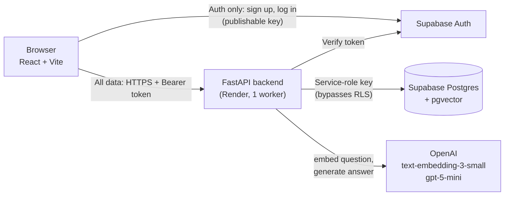

# TekaTech architecture and trade-off notes

S4-MA deliverable (Manuel Mirasol, 30 Oct 2026). AI-assisted (Claude Code), checked by Manuel against the code and the evidence files named below.

This page explains **where the boundaries are, what was chosen, what each choice costs, and what the team knowingly accepted**. It does not repeat the API reference (`backend/README.md`), the database setup (`docs/database.md`) or the AI write-up (`docs/ai-feature-writeup.md`); it links to them.

**How to read the "why".** Reasons come from code comments, PR descriptions and evidence files, each named. Where a reason is my own reading and nobody wrote it down, it says **(inferred)**.

---

## 1. The system in one picture

A question to `POST /query` runs this path: **embed the question → fetch the nearest saved spec chunks → number them → ask the model to answer only from those numbers → strip any citation that points outside what was sent → return the answer with its sources.** The browser never sees a key, a prompt or a raw provider error.

## 2. Boundaries: who owns what, and what each side never does

| Side | Owns | Never does |
| --- | --- | --- |
| **Browser** (React) | Presentation, form state, rendering citations (`[n]`, bold, bullets only) | Reads or writes data tables; holds the service key; talks to OpenAI |
| **FastAPI backend** | Every authorization decision, input validation, retrieval, the prompt, answer validation, cost limits, failure messages | Trusts the client for the admin flag; shows a provider's error text; saves partial AI output |
| **Supabase** | Storage, vector search (`match_spec_documents`), user accounts and tokens | Decides who may do what (the backend's service key bypasses Row Level Security) |
| **OpenAI** | Embeddings and the answer text | Sees anything but the question, the retrieved snippets and the fixed prompt |

The three boundaries the course asks about:
- **Backend ↔ data:** the backend is the only thing that touches data tables (section 3, D1 and D2).
- **Backend ↔ AI:** the model is called from exactly one place per purpose (`routers/query.py` for answers, `embeddings.py` for vectors), with capped output and validated results (D5, D6).
- **Browser ↔ backend:** the contract is the API reference, and the UI only renders what the prompt rules allow (D5).

## 3. Decisions, trade-offs and evidence

Each entry: **what was chosen**, **why**, **the alternative**, **what it costs**, **where to check it**.

### D1. The browser never queries data tables
- **Chosen:** Supabase is used from the browser for sign-up and log-in only. Every other request goes to FastAPI with the user's token (`frontend/src/api/client.js`).
- **Why:** the backend connects with the service-role key, which ignores Row Level Security, so database policies would add nothing here. Keeping all reads and writes behind one door puts validation, rate limiting and logging in one place.
- **Alternative:** let the browser read tables directly under RLS. Rejected because RLS and a service-role backend would be two competing access-control systems **(inferred)**.
- **Cost:** every page load goes through the API, so a sleeping free-tier server delays the whole app (D12).
- **Check:** `docs/database.md` (RLS enabled, direct browser privileges revoked), `CLAUDE.md` ("The frontend never queries data tables").

### D2. Authorization lives in route code, and the admin flag is not user-editable
- **Chosen:** three FastAPI dependencies decide access: none (public), `get_current_user`, `get_current_admin_user`. Admin is `app_metadata.is_admin`, which only the service key can set. `user_metadata` is client-writable and is never trusted.
- **Why:** because RLS is bypassed, a route that forgets its dependency is a hole.
- **Alternative:** a role table or RLS-based roles. More moving parts for a five-route admin surface **(inferred)**.
- **Cost:** one missing `Depends(...)` is an open endpoint. Mitigation: an authorization matrix test classifies all 22 routes, checks the wiring, and calls each as anonymous, bad-token, user, "claims admin in `user_metadata`" and admin callers (PR #157, in review at the time of writing).
- **Deliberate public routes:** `POST /query`, `POST /comparisons`, `GET /comparisons/{slug}`, `/stats/*` and the gadget/spec reads. The rate limit is their only guard (D9).

### D3. Saving a spec never depends on the AI
- **Chosen:** saving splits the text into chunks and stores them with no embedding and status `pending`, with no AI call. A separate `POST .../index` embeds one chunk later. If the provider fails, the saved text stays.
- **Why:** an AI outage must not lose a contributor's work (`docs/claude-handoff.md`, "Saving specifications is independent of AI indexing").
- **Stale-vector protection:** indexing only attaches an embedding if the text is unchanged while OpenAI ran (`eq("content", ...)`, otherwise 409), and a database trigger clears the embedding and resets to `pending` when a chunk's content changes.
- **Cost:** a new spec is readable but not answerable until someone presses **Index**; the UI shows **Pending AI Indexing** so this is visible.
- **Check:** `backend/routers/specs.py`; the trigger is asserted in `backend/tests/sql/schema_acceptance.sql`.

### D4. Retrieval: small chunks, vector search, scope decides the cutoff
- **Chosen:** chunks of about 300 tokens (hard limit 500) in a pgvector table; the question is embedded and the nearest `MATCH_COUNT = 6` chunks go to the model.
  - A question that names gadgets (`gadget_ids`: the gadget page and the compare page) gets the nearest 6 of **those gadgets whatever their score**.
  - A question with no gadget (the catalog's ask box) keeps a similarity cutoff of **0.25**.
  - If the vector search finds nothing, a keyword fallback (up to 4 chunks) tries the same scope.
- **Why (measured, `docs/evidence/retrieval-threshold-2026-10-27.md`, issue #88):** relevant and irrelevant chunks overlap heavily (similarity 0.26 to 0.61), so no threshold separates them. What a threshold *can* separate is on-topic from off-topic questions: no off-topic question scored above 0.22, and no relevant chunk scored below 0.26. The old cutoff of 0.5 kept only 13 of 39 relevant pairs, and only 13 of the 23 answerable questions got a relevant chunk at all; at 0.25 all 23 do. With the fix, supported claims went from 5 of 13 to 11 of 13 (`docs/evidence/eval-s4-2026-10-26-scoped.md`; re-measured on current `main` in PR #151).
- **Alternative:** one global threshold. It cannot do both jobs: a low one sends junk for off-topic questions, a high one drops the right snippet.
- **Cost:** a scoped question now always sends the model some context, so a "not stated" answer costs a model call (about $0.0007) instead of a free canned reply. The prompt then has to say "not stated", which it does.
- **Limits:** measured on a small dev corpus (10 verified snippets, two gadgets); production gadgets with more chunks will exercise the ranking harder.

### D5. Ground, cite, then validate the output
- **Chosen:** the prompt tells the model to answer only from numbered snippets and cite `[1]`, `[2]`. Snippets are framed as untrusted data. After the model answers, `citations.py` removes any `[n]` that points outside the snippets that were sent, and `/query` reports how many it removed (`invalid_citations_removed`). The frontend renders exactly three things: citations, bold and bullets, and the prompt's formatting rules are tied to that.
- **Why:** the course asks that the backend validate or act on AI output, and a pass-through chatbot is not enough. A dead citation would look like evidence that doesn't exist.
- **Reduced risk (stated in `CLAUDE.md`):** spec text goes into the model's context. Since 3 Nov 2026 only admins add specs, and user corrections reach it only after admin approval, so this stored-prompt-injection surface is admin-reviewed input. The prompt's untrusted-data framing is the mitigation, and an override test case (TC-20) checks it.
- **Cost:** the prompt and the renderer must change together or markup shows as literal text with no error.
- **Check:** `backend/prompts.py`, `backend/citations.py`, `docs/ai-feature-writeup.md`.

### D6. Cost is capped on every layer, because `/query` is public
- **Chosen:**
  - **Per answer:** `max_completion_tokens = 1500` and `reasoning_effort = "low"`. `gpt-5-mini` bills hidden reasoning as output ($2.00 per million tokens against $0.25 for input). An answer that hits the cap is a safe 503, never shown cut off.
  - **Per request:** a character cap then a token cap on questions (150 chars, 160 tokens), counted with the right tokenizer for each model.
  - **Per caller:** rate limits (`/query` 10 per minute; writes 20 per hour).
  - **Repeats:** an in-process answer cache (exact match, or an embedding similarity of at least 0.95), which skips the paid calls.
  - **Overall:** the team shares a $10 prepaid balance with auto-reload off, so spending stops at zero.
- **Why (measured):** on 4 real answers the cap cut cost from $0.0047 to $0.0019 (about 60% lower); about 87% of the uncapped output tokens were hidden reasoning (PR #103). A comparison answer costs about $0.0009 on dev and a worst-case answer about $0.004, bounded by the context cap, so $10 covers roughly 2,500 worst-case answers (`docs/evidence/comparison-cost-2026-10-30.md`, in PR #157).
- **Cost of the cost control:** an occasional long answer becomes a 503 instead of a partial one, and the cache can serve a slightly older answer for up to an hour after an edit made outside the API.
- **Limits:** the 60% figure is 4 answers against a one-chunk production database, a measure of the cap's effect and not of answer quality.

### D7. Every AI failure becomes one safe sentence
- **Chosen:** `/query` returns `503 {"detail": "<plain sentence>"}` for a provider timeout, quota, connection error, unusable output or an over-long answer. No provider error text ever reaches the client. The failure drill simulates each mode without calling OpenAI, for admins only, with the flag off by default.
- **Why:** the browser picks its failure screen from the start of the sentence, and a raw provider message could leak internals or confuse users.
- **Related guards:** a dropped Supabase connection is retried once for reads and deletes and never for writes (a save cannot be applied twice); `/health` checks only that the process is alive, while `/health/ready` adds one database read, so a database blip cannot make the host restart a healthy process; an unexpected error returns a `500` with a request id and no exception text.
- **Evidence:** dev drill and production drill (PRs #151 and #153, each mode returned its safe message; non-admin, anonymous and flag-off callers got normal answers).
- **Limit:** the production drill needed the flag set temporarily in the host's dashboard, a documented exception (`backend/README.md`, "Supervised production drill").

### D8. One worker, with in-process state, and no silent fallback
- **Chosen:** the API runs `--workers 1` on Render. Rate-limit counters, the read cache and the answer cache all live in the process. If a shared rate-limit store is configured but unreachable, startup fails instead of falling back to per-process counters.
- **Why:** per-process counters look healthy while the protection is gone, so a loud failure is better than a quiet downgrade (`backend/rate_limit.py`).
- **Cost:** it does not scale out. More workers or replicas need a shared store (Redis) for the limiter and a shared cache, or each worker would enforce its own quota and serve answers another worker has already invalidated.
- **Fits the course scope:** one free-tier worker is what the project runs on.

### D9. The schema is plain SQL, applied by hand, safe to repeat
- **Chosen:** all tables and functions are files in `backend/sql/`, applied by the owner in the Supabase SQL Editor. CI applies them **twice** to a scratch Postgres with pgvector and then runs acceptance checks, so every file must be replay-safe. Deploys never touch the database.
- **Why:** a deploy that silently changes production data is the riskier failure. A new function reaching production only after the owner runs it was the rule when the keyword fallback shipped (its SQL went to dev and production before the code merged).
- **Cost:** a code change that needs SQL can be merged before the SQL is applied; the team handles that by ordering (SQL first) and by writing code that degrades safely (the keyword fallback logs once and answers without it if its function is missing).
- **Check:** `docs/database.md`, `backend/scripts/assemble_sql.py`, `.github/workflows/ci.yml`.

### D10. OpenAI only, two models
- **Chosen:** `text-embedding-3-small` for vectors (1536 dimensions) and `gpt-5-mini` for answers. The optional local Ollama mode was dropped by the project owner on 16 Oct 2026; only the historical Sprint 1 probe remains.
- **Why:** one provider means one failure mode to test and one bill to cap. The project is restricted to those two models in the provider dashboard.
- **Cost:** a provider outage is a total AI outage (spec browsing still works), and a model change invalidates the answer cache and may change the evaluation scores.

### D11. Free hosting, with its limits disclosed
- **Chosen:** the API and the static frontend run on Render's free plan (Singapore); the database is Supabase; deploys happen through CI after all checks pass.
- **Cost, measured:** the free API sleeps after about 15 minutes idle, and the first request then took 42 to 55 seconds (four single samples, `docs/devops/app-performance.md`). The UI shows a "server is waking up" state when a request waits that long (`frontend/src/api/serverStatus.js`).
- **Not built:** a staging environment. It is disclosed as not implemented for the release, with mitigations (a separate dev database for destructive tests, mocked CI, browser checks), in `docs/devops/environments.md`; that wording is in PR #154, and `main` still lists it as an open Sprint 3 target until #154 merges.

## 4. Known limits and accepted risks

| Limit | Impact | Why accepted | Where it is recorded |
| --- | --- | --- | --- |
| Stored prompt injection through spec text | A contributor's text reaches the model | Ingestion is open to logged-in users by design; mitigated by untrusted-data framing | `CLAUDE.md` |
| Single worker, in-process caches and counters | Does not scale out; a restart empties the caches | Free-tier scope; failing loudly beats degrading silently | D8 |
| Free-tier cold start (42–55 s) | First request after idle is slow | No paid plan | D11 |
| No staging environment | Changes are first seen in production | Disclosed (PR #154 updates the environments doc) | `docs/devops/environments.md` |
| Evaluation: abstention 0 of 7 as scored | The scorer fails refusals that cite a snippet or quote a value | These are scorer gaps (issue #66), not model behaviour; the report says so | PR #151, issue #66 |
| Measured on a small dev corpus | Retrieval and cost figures may differ on larger production gadgets | The worst-case cost is computed from the code's limits | D4, D6 |
| Public endpoints | `/query` and comparison creation are open | Rate limits are the only guard, by design | D2 |

## 5. What would change at scale

1. **A shared store (Redis)** for the rate limiter, the read cache and the answer cache, then more than one worker.
2. **A staging environment** so a change is seen before users see it.
3. **A background job for indexing**, so a new spec becomes answerable without a manual step.
4. **A real evaluation gate in CI** once the scorer handles refusals (issue #66), so a prompt or retrieval change cannot lower quality unseen.

## 6. The 60-second version, for the demo

> The browser only does sign-in and display; every read and write goes through our FastAPI backend, which is the only thing that touches the database. The backend uses a service key that bypasses database policies, so every permission check is in route code and covered by a test that tries every route as every kind of caller. Questions are embedded, matched against saved spec chunks, and the model may answer only from the numbered snippets it is given; the backend strips any citation that points outside them and turns any AI failure into one safe sentence. Saving specs never depends on the AI, so an outage can't lose data. Cost is capped at every layer because the endpoint is public: capped output, question limits, rate limits, an answer cache and a $10 prepaid balance. We chose one worker on a free host and say so: it doesn't scale out, and we know what we'd change if it had to.

## 7. Where to look

| Topic | File |
| --- | --- |
| Routes, status codes, headers, limits | `backend/README.md` (API reference) |
| Tables, relationships, manual SQL steps | `docs/database.md` |
| Prompt rules, evaluation, AI limits | `docs/ai-feature-writeup.md` |
| Retrieval measurement | `docs/evidence/retrieval-threshold-2026-10-27.md` |
| Scoped-retrieval and current-`main` evaluation | `docs/evidence/eval-s4-2026-10-26-scoped.md`, PR #151 |
| Failure drills | `backend/README.md` ("Failure drill"), PRs #151 and #153 |
| Hosting, deploy, rollback | `docs/deploy-runbook.md`, `docs/devops/environments.md` |
| Cost measurement | PR #157 (`docs/evidence/comparison-cost-2026-10-30.md`) |
