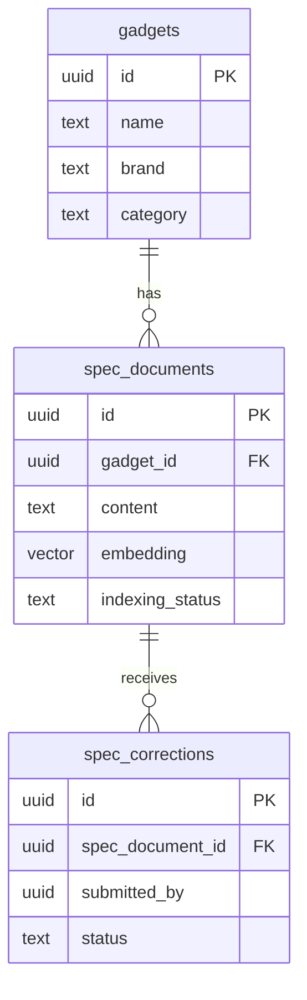

# Database model and manual migration

Supabase supplies Postgres, Auth and the anon/authenticated/service_role roles. The browser uses Auth only. The backend uses the service-role key, so route authorization remains the primary access control. SQL enables RLS and revokes browser table/RPC access; it does not change who may submit specs through FastAPI.

| Table | Purpose and relationships |
| --- | --- |
| gadgets | Core catalog resource: name, brand, category, release date, PHP price and image |
| spec_documents | Many sourced text chunks per gadget; gadget_id foreign key; 1536-dimension vector; pending/indexed state |
| spec_corrections | Suggestions linked to one spec_document; submitted/reviewed auth-user UUIDs |
| comparison_links | Unique slug and selected gadget UUID array; atomic view count |
| query_history | Question/answer, retrieved gadget references, model and token usage |

Deleting a gadget cascades to its spec chunks and their corrections. Comparison/history UUID arrays are historical references, not foreign-key relationships; shared comparisons must tolerate removed gadgets. User UUIDs are kept as scalar references so this baseline is reproducible in scratch Postgres without recreating Supabase-managed Auth tables.



## Live project status

The existing TekaTech project is ACTIVE_HEALTHY; [verification evidence](evidence/supabase-sprint-1.json) records both registered migrations, permissions, relationships and backend reads. Its vector extension is in `public`, and the SQL supports that location as well as `extensions`. The existing project also has `profiles`, `image_lookups` and `ingestion_queue` plus Auth-user foreign keys/nullable fields beyond the minimal fresh-project baseline. Those restored tables and relationships were retained. This baseline is not a full export of the existing project.

Wait for ACTIVE_HEALTHY before schema inspection/migration. A COMING_UP response returned an empty public catalog during restoration; the real schema appeared later.

## Application order

Run these in Supabase SQL Editor as the project postgres owner:

1. `backend/sql/001_baseline.sql` (new-project baseline)
2. `backend/sql/save_specs_before_indexing.sql`
3. `backend/sql/add_query_history_token_columns.sql`
4. `backend/sql/match_spec_documents.sql`
5. `backend/sql/keyword_match_spec_documents.sql` (keyword fallback for `/query`, issue #88; revokes browser access to its own function)
6. `backend/sql/increment_comparison_view_count.sql`
7. `backend/sql/user_gadgets.sql` (My Gadgets, 3 Nov 2026: one table, private to the backend)
8. `backend/sql/api_access.sql` (last, to restrict RPC/table grants)

### Adding My Gadgets to an existing project

Projects set up before 3 November 2026 need only step 7, and it must run **before** the backend that serves `/me/gadgets` is deployed. Paste `backend/sql/user_gadgets.sql` into the SQL Editor and run it once as the project owner. It creates the `user_gadgets` table (`create table if not exists`, safe to re-run) with a `(user_id, gadget_id)` primary key, an index, `on delete cascade` from `gadgets`, RLS on, no browser access, and `service_role` access, then reloads the PostgREST schema cache. It changes no existing table or data. Check it with:

```sql
select relrowsecurity from pg_class where oid = 'public.user_gadgets'::regclass;  -- true
select has_table_privilege('authenticated', 'public.user_gadgets', 'SELECT');    -- false
```

### Adding the keyword fallback to an existing project

Projects set up before 27 October 2026 need only step 5. Paste `backend/sql/keyword_match_spec_documents.sql` into the SQL Editor and run it once as the project owner, on DEV first and then on the live project. It creates one function (`create or replace`, safe to re-run), revokes it from `public`/`anon`/`authenticated`, grants it to `service_role`, and reloads the PostgREST schema cache. It changes no table, index or data. Check it with:

```sql
select has_function_privilege('anon', 'public.keyword_match_spec_documents(vector,text,text[],integer,uuid[])', 'EXECUTE') as anon_can_run,  -- expect false
       has_function_privilege('service_role', 'public.keyword_match_spec_documents(vector,text,text[],integer,uuid[])', 'EXECUTE') as backend_can_run;  -- expect true
```

The backend works before this step. Until the function exists, a question with no vector match logs one warning ("Keyword fallback unavailable") and returns the usual "no relevant specs" answer. Applying it needs no deploy or restart.

Generate a single pasteable setup file in PowerShell from the repository root:

```powershell
New-Item -ItemType Directory -Force .local | Out-Null
backend/.venv/Scripts/python.exe backend/scripts/assemble_sql.py | Set-Content -Encoding utf8 .local/supabase-setup.sql
```

The assembler prints SQL only. It never connects to or migrates a database. For an existing project, export/inspect its schema, compare column and RPC signatures, and take a backup before applying changes. `CREATE TABLE IF NOT EXISTS` does not repair differing table definitions. `CREATE OR REPLACE FUNCTION` cannot change an incompatible existing return signature. The tracked retrieval SQL recognizes only the inspected five-column legacy `(vector,uuid[],integer,double precision)` signature, verifies zero dependents, and removes it without CASCADE before preserving the canonical RPC. Unknown result shapes or dependent objects abort for inspection. This resolves PostgREST PGRST203 when same-named arguments exist in differently ordered overloads.

Pending chunks have no embedding and cannot participate in vector retrieval. Indexing writes compare the original content. A content edit clears its old vector and resets pending status through a database trigger.

## Verification

The CI database job applies the ordered setup twice to a fresh pgvector/Postgres database. `schema_acceptance.sql` checks retrieval scope (vector and keyword), pending exclusion, keyword unit patterns, correction invalidation, view counters, telemetry, RLS/grants and cascades with rolled-back fixtures. Additional scratch checks reproduce and reconcile the legacy RPC and cover vector in either schema. Live read-only verification now passes against the actual Supabase project; scratch fixture SQL remains CI-only.

Run `backend/scripts/sprint1_check.py` after connecting/resuming Supabase to verify actual table columns and the match RPC. `/gadgets` must return real database data through the backend before the live walking skeleton is accepted.
