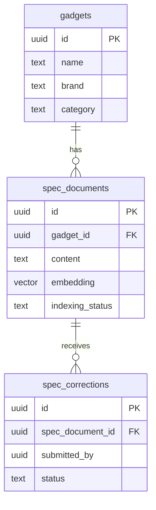

# Database model and manual migration

Supabase supplies Postgres, Auth and the anon/authenticated/service_role roles. The browser uses Auth only. The backend uses the service-role key, so route authorization remains the primary access control. SQL enables RLS and revokes browser table/RPC access; it does not change who may submit specs through FastAPI.

| Table | Purpose and relationships |
| --- | --- |
| gadgets | Core catalog resource: name, brand, category, release date, PHP price and image |
| spec_documents | Many sourced text chunks per gadget; gadget_id foreign key; 1536-dimension vector; pending/indexed state |
| spec_corrections | Suggestions linked to one spec_document; submitted/reviewed auth-user UUIDs |
| comparison_links | Unique slug and selected gadget UUID array; atomic view count |
| query_history | Question/answer, retrieved gadget references, model and token usage |

Deleting a gadget cascades to its spec chunks and their corrections. Comparison/history UUID arrays are historical references, not foreign-key relationships; shared comparisons must tolerate removed gadgets. User UUIDs are kept as scalar references so this baseline is reproducible in scratch Postgres without recreating Supabase-managed Auth tables.



## Application order

Run these in Supabase SQL Editor as the project postgres owner:

1. `backend/sql/001_baseline.sql` (new-project baseline)
2. `backend/sql/save_specs_before_indexing.sql`
3. `backend/sql/add_query_history_token_columns.sql`
4. `backend/sql/match_spec_documents.sql`
5. `backend/sql/increment_comparison_view_count.sql`
6. `backend/sql/api_access.sql` (last, to restrict RPC/table grants)

Generate a single pasteable setup file in PowerShell from the repository root:

```powershell
New-Item -ItemType Directory -Force .local | Out-Null
backend/.venv/Scripts/python.exe backend/scripts/assemble_sql.py | Set-Content -Encoding utf8 .local/supabase-setup.sql
```

The assembler prints SQL only. It never connects to or migrates a database. For an existing project, export/inspect its schema, compare column and RPC signatures, and take a backup before applying changes. `CREATE TABLE IF NOT EXISTS` does not repair differing table definitions. `CREATE OR REPLACE FUNCTION` cannot change an incompatible existing return signature; inspect and reconcile it rather than dropping functions blindly.

Pending chunks have no embedding and cannot participate in vector retrieval. Indexing writes compare the original content. A content edit clears its old vector and resets pending status through a database trigger.

## Verification

The CI database job applies the ordered setup twice to a fresh pgvector/Postgres database. `schema_acceptance.sql` checks retrieval scope, pending exclusion, correction invalidation, view counters, telemetry, RLS/grants and cascades with rolled-back fixtures. These local checks also passed in temporary PGlite/pgvector on 12 October 2026; this does not confirm the actual Supabase migration.

Run `backend/scripts/sprint1_check.py` after connecting/resuming Supabase to verify actual table columns and the match RPC. `/gadgets` must return real database data through the backend before the live walking skeleton is accepted.
