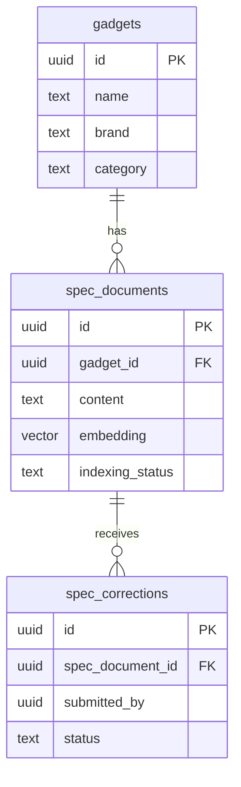

# Database model and manual migration

Supabase supplies Postgres, Auth and the anon/authenticated/service_role roles. The browser uses Auth only. The backend uses the service-role key, so route authorization remains the primary access control. SQL enables RLS and revokes browser table/RPC access; it does not change who may submit specs through FastAPI.

| Table | Purpose and relationships |
| --- | --- |
| gadgets | Core catalog resource: name, brand, category, release date, PHP price and image |
| spec_documents | Many sourced text chunks per gadget; gadget_id foreign key; 1536-dimension vector; pending/indexed state |
| spec_corrections | Suggestions linked to one spec_document; submitted/reviewed auth-user UUIDs |
| comparison_links | Unique slug and selected gadget UUID array; atomic view count |
| query_history | Question/answer, retrieved gadget references, model and token usage |

Deleting a gadget cascades to its spec chunks and their corrections. Comparison/history UUID arrays are historical references, not foreign-key relationships; shared comparisons must tolerate removed gadgets. User UUIDs are kept as scalar references so this baseline is reproducible in scratch Postgres without recreating Supabase-managed Auth tables.



## Live project status

The existing TekaTech project is ACTIVE_HEALTHY; [verification evidence](evidence/supabase-sprint-1.json) records both registered migrations, permissions, relationships and backend reads. Its vector extension is in `public`, and the SQL supports that location as well as `extensions`. The existing project also has `profiles`, `image_lookups` and `ingestion_queue` plus Auth-user foreign keys/nullable fields beyond the minimal fresh-project baseline. Those restored tables and relationships were retained. This baseline is not a full export of the existing project.

Wait for ACTIVE_HEALTHY before schema inspection/migration. A COMING_UP response returned an empty public catalog during restoration; the real schema appeared later.

## Application order

Run these in Supabase SQL Editor as the project postgres owner:

1. `backend/sql/001_baseline.sql` (new-project baseline)
2. `backend/sql/save_specs_before_indexing.sql`
3. `backend/sql/add_query_history_token_columns.sql`
4. `backend/sql/match_spec_documents.sql`
5. `backend/sql/keyword_match_spec_documents.sql` (keyword fallback for `/query`, issue #88; revokes browser access to its own function)
6. `backend/sql/increment_comparison_view_count.sql`
7. `backend/sql/user_gadgets.sql` (My Gadgets, 3 Nov 2026: one table, private to the backend)
8. `backend/sql/user_questions.sql` (per-gadget AI conversation, 3 Nov 2026: one table, private to the backend)
9. `backend/sql/user_comparison_questions.sql` (per-comparison AI conversation, 23 Nov 2026: one table plus a gadget-delete trigger, private to the backend)
10. `backend/sql/gadget_price_source.sql` (sourced prices, 14 Nov 2026: three nullable columns on `gadgets`)
11. `backend/sql/gadget_price_launch.sql` (launch prices, 15 Nov 2026: one boolean column on `gadgets`, default false)
12. `backend/sql/api_access.sql` (restricts RPC/table grants)
13. `backend/sql/gadget_benchmarks.sql` (published game and chip benchmarks, 24 Nov 2026: one table, private to the backend, removed with the gadget)
14. `backend/sql/lock_browser_roles.sql` (always last: removes every browser-role right in `public`, including tables no file names, and stops Supabase's defaults from granting new objects to the browser; 14 Nov 2026)

### Browser-role lock (14 Nov 2026)

A read-only check of production on 14 Nov 2026 found RLS on all ten tables, but three untracked leftover tables (`profiles`, `image_lookups`, `ingestion_queue`, unused by the app) with full `anon`/`authenticated` rights including TRUNCATE (not covered by RLS); default privileges that grant every new table and function to the browser roles; five old policies with no effect; and `set_updated_at()` without a fixed `search_path`. `lock_browser_roles.sql` fixes all of these and is replay-safe. It does not drop the leftover tables (that is a separate decision). To apply on an existing project: paste the file into the SQL Editor of the right project (check the project ref in the URL), run it, then re-run the check query from the PR. Expected: no `browser_grants`, no `policies`, and `anon`/`auth` false for every function except Supabase's `rls_auto_enable()`. The backend uses `service_role`, which keeps full rights, so the app is unaffected.

### Adding My Gadgets to an existing project

Projects set up before 3 November 2026 need only step 7, and it must run **before** the backend that serves `/me/gadgets` is deployed. Paste `backend/sql/user_gadgets.sql` into the SQL Editor and run it once as the project owner. It creates the `user_gadgets` table (`create table if not exists`, safe to re-run) with a `(user_id, gadget_id)` primary key, an index, `on delete cascade` from `gadgets`, RLS on, no browser access, and `service_role` access, then reloads the PostgREST schema cache. It changes no existing table or data. Check it with:

```sql
select relrowsecurity from pg_class where oid = 'public.user_gadgets'::regclass;  -- true
select has_table_privilege('authenticated', 'public.user_gadgets', 'SELECT');    -- false
```

### Adding the per-gadget AI conversation to an existing project

Projects set up before 3 November 2026 need only step 8, and it must run **before** the backend that writes it is deployed (`POST /query` would otherwise log a failed save on every signed-in single-gadget question, and the gadget page would show "Couldn't load your earlier questions"). Paste `backend/sql/user_questions.sql` into the SQL Editor and run it once as the project owner. It creates the `user_questions` table (`create table if not exists`, safe to re-run): one row per saved question with its full validated answer as `jsonb`, an index on `(user_id, gadget_id, created_at desc)`, `on delete cascade` from `gadgets`, RLS on, no browser access and `service_role` access, then reloads the PostgREST schema cache. It changes no existing table or data. Check it with:

```sql
select relrowsecurity from pg_class where oid = 'public.user_questions'::regclass;  -- true
select has_table_privilege('authenticated', 'public.user_questions', 'SELECT');    -- false
```

### Adding benchmarks to an existing project

Projects set up before 24 November 2026 need only step 13. Run it **before** deploying the backend that reads it, on DEV first and then on the live project; then re-run step 14 (`lock_browser_roles.sql`, replay-safe). Until it is applied, `GET /gadgets/{id}/benchmarks` fails (the phone page hides the section for visitors) and AI answers skip benchmarks (logged, the answer still works). Paste `backend/sql/gadget_benchmarks.sql` into the SQL Editor and run it once. It creates `gadget_benchmarks` (`create table if not exists`, safe to re-run) with checks on kind, text lengths, value range and an http(s) source link, an index on `(gadget_id, kind, test)`, RLS on, no browser access, and reloads the PostgREST schema cache. It changes no existing table or data. Check it with:

```sql
select relrowsecurity from pg_class where oid = 'public.gadget_benchmarks'::regclass;   -- true
select has_table_privilege('anon', 'public.gadget_benchmarks', 'SELECT');                -- false
```

### Adding the per-comparison AI conversation to an existing project

Projects set up before 23 November 2026 need only step 9. Run it **before** deploying the backend that writes it, on DEV first and then on the live project. Until it is applied, every signed-in comparison question logs a failed save (the answer still works) and the compare page shows "Couldn't load your earlier questions". Paste `backend/sql/user_comparison_questions.sql` into the SQL Editor and run it once as the project owner. It creates the `user_comparison_questions` table (`create table if not exists`, safe to re-run): one row per saved comparison question, keyed by the user and `comparison_key` (the sorted, comma-joined gadget ids, so the same phones in any order are one conversation), with the full validated answer as `jsonb`. `gadget_ids uuid[]` must hold at least two ids. Because an array can't carry a foreign key, an `after delete` trigger on `gadgets` (`gadgets_delete_comparison_questions`) removes saved turns that include a deleted gadget. It also adds a GIN index for that trigger and an index on `(user_id, comparison_key, created_at desc)`. RLS is on, there is no browser access and `service_role` keeps access; the trigger function is revoked from the browser roles. It then reloads the PostgREST schema cache. It changes no existing table or data. Check it with:

```sql
select relrowsecurity from pg_class where oid = 'public.user_comparison_questions'::regclass;  -- true
select has_table_privilege('authenticated', 'public.user_comparison_questions', 'SELECT');    -- false
select tgname from pg_trigger where tgname = 'gadgets_delete_comparison_questions';           -- one row
```

### Adding sourced prices to an existing project

Existing projects need only step 10, and it must run **before** the backend that writes these columns is deployed (an admin save that sends a price source would otherwise fail). Paste `backend/sql/gadget_price_source.sql` into the SQL Editor and run it once as the project owner, on DEV first and then on the live project. It adds `price_source_url text`, `price_checked_at date` and `store_url text` to `gadgets` (`add column if not exists`), two http/https check constraints (dropped and re-added, safe to re-run), and reloads the PostgREST schema cache. Existing rows keep NULLs; no data changes. Reviewed price values for the catalog are a separate, hand-applied file: `docs/catalog-data/prices-2026-11-14.sql`. Check it with:

```sql
select column_name, data_type from information_schema.columns
where table_schema = 'public' and table_name = 'gadgets'
  and column_name in ('price_source_url', 'price_checked_at', 'store_url');  -- 3 rows
```

### Adding the launch-price flag to an existing project

Projects set up before 15 November 2026 need only step 11, and it must run **before** the frontend that sends `price_is_launch` is deployed (an admin save that ticks "Launch price" would otherwise fail). Paste `backend/sql/gadget_price_launch.sql` into the SQL Editor and run it once as the project owner, on DEV first and then on the live project. It adds `price_is_launch boolean not null default false` to `gadgets` (`add column if not exists`, safe to re-run) and reloads the PostgREST schema cache. Existing rows get `false`; no other data changes. Check it with:

```sql
select column_name, data_type, is_nullable, column_default from information_schema.columns
where table_schema = 'public' and table_name = 'gadgets' and column_name = 'price_is_launch';
-- 1 row: boolean, NO, false
```

### Adding the keyword fallback to an existing project

Projects set up before 27 October 2026 need only step 5. Paste `backend/sql/keyword_match_spec_documents.sql` into the SQL Editor and run it once as the project owner, on DEV first and then on the live project. It creates one function (`create or replace`, safe to re-run), revokes it from `public`/`anon`/`authenticated`, grants it to `service_role`, and reloads the PostgREST schema cache. It changes no table, index or data. Check it with:

```sql
select has_function_privilege('anon', 'public.keyword_match_spec_documents(vector,text,text[],integer,uuid[])', 'EXECUTE') as anon_can_run,  -- expect false
       has_function_privilege('service_role', 'public.keyword_match_spec_documents(vector,text,text[],integer,uuid[])', 'EXECUTE') as backend_can_run;  -- expect true
```

The backend works before this step. Until the function exists, a question with no vector match logs one warning ("Keyword fallback unavailable") and returns the usual "no relevant specs" answer. Applying it needs no deploy or restart.

### Adding gadget photo uploads (Supabase Storage bucket)

Admins can upload a gadget photo (`POST /gadgets/{gadget_id}/image`, 15 Nov 2026, issue #202). The API stores it in a **public** Supabase Storage bucket named `gadget-images` and sets the gadget's `image_url` to the object's public URL. The bucket must exist in each Supabase project; it is not part of the numbered list above, because the `storage` schema exists only in Supabase and CI's plain Postgres would fail on it. That is why the file lives in `backend/sql/manual/` and is **not** registered in `assemble_sql.py`.

Paste `backend/sql/manual/gadget_images_bucket.sql` into the SQL Editor and run it once as the project owner, on DEV first and then on the live project. It inserts the bucket (`on conflict (id) do update`, safe to re-run) with `public = true`, a 2 MB `file_size_limit` (2097152 bytes) and `allowed_mime_types` JPEG, PNG, WebP and AVIF, then selects the row so you can see it. It changes no table or data in `public`. Until it runs, every upload answers 503 "Couldn't store the photo right now" and the gadget is left unchanged; pasting an image link keeps working. Applying it needs no deploy or restart.

Do **not** add a storage policy for this bucket. The backend uploads with the service-role key, which bypasses RLS, and only after `get_current_admin_user`; a public bucket serves reads through its public URL without any policy. An `insert`/`update`/`delete` (or `select`) policy on `storage.objects` would let browser sessions write or list photos directly, around the API's size and magic-byte checks. Check it with:

```sql
select id, public, file_size_limit, allowed_mime_types from storage.buckets where id = 'gadget-images';
-- 1 row: true, 2097152, {image/jpeg,image/png,image/webp,image/avif}
select count(*) from pg_policies where schemaname = 'storage' and tablename = 'objects'
  and (qual ilike '%gadget-images%' or with_check ilike '%gadget-images%');  -- expect 0
```

The frontend CSP already allows the photos (`img-src 'self' https: data:` in `render.yaml`); the upload itself goes to the API, which `connect-src` lists.

Generate a single pasteable setup file in PowerShell from the repository root:

```powershell
New-Item -ItemType Directory -Force .local | Out-Null
backend/.venv/Scripts/python.exe backend/scripts/assemble_sql.py | Set-Content -Encoding utf8 .local/supabase-setup.sql
```

The assembler prints SQL only. It never connects to or migrates a database. For an existing project, export/inspect its schema, compare column and RPC signatures, and take a backup before applying changes. `CREATE TABLE IF NOT EXISTS` does not repair differing table definitions. `CREATE OR REPLACE FUNCTION` cannot change an incompatible existing return signature. The tracked retrieval SQL recognizes only the inspected five-column legacy `(vector,uuid[],integer,double precision)` signature, verifies zero dependents, and removes it without CASCADE before preserving the canonical RPC. Unknown result shapes or dependent objects abort for inspection. This resolves PostgREST PGRST203 when same-named arguments exist in differently ordered overloads.

Pending chunks have no embedding and cannot participate in vector retrieval. Indexing writes compare the original content. A content edit clears its old vector and resets pending status through a database trigger.

## Verification

The CI database job applies the ordered setup twice to a fresh pgvector/Postgres database. `schema_acceptance.sql` checks retrieval scope (vector and keyword), pending exclusion, keyword unit patterns, correction invalidation, view counters, telemetry, RLS/grants and cascades with rolled-back fixtures. Additional scratch checks reproduce and reconcile the legacy RPC and cover vector in either schema. Live read-only verification now passes against the actual Supabase project; scratch fixture SQL remains CI-only.

Run `backend/scripts/sprint1_check.py` after connecting/resuming Supabase to verify actual table columns and the match RPC. `/gadgets` must return real database data through the backend before the live walking skeleton is accepted.
