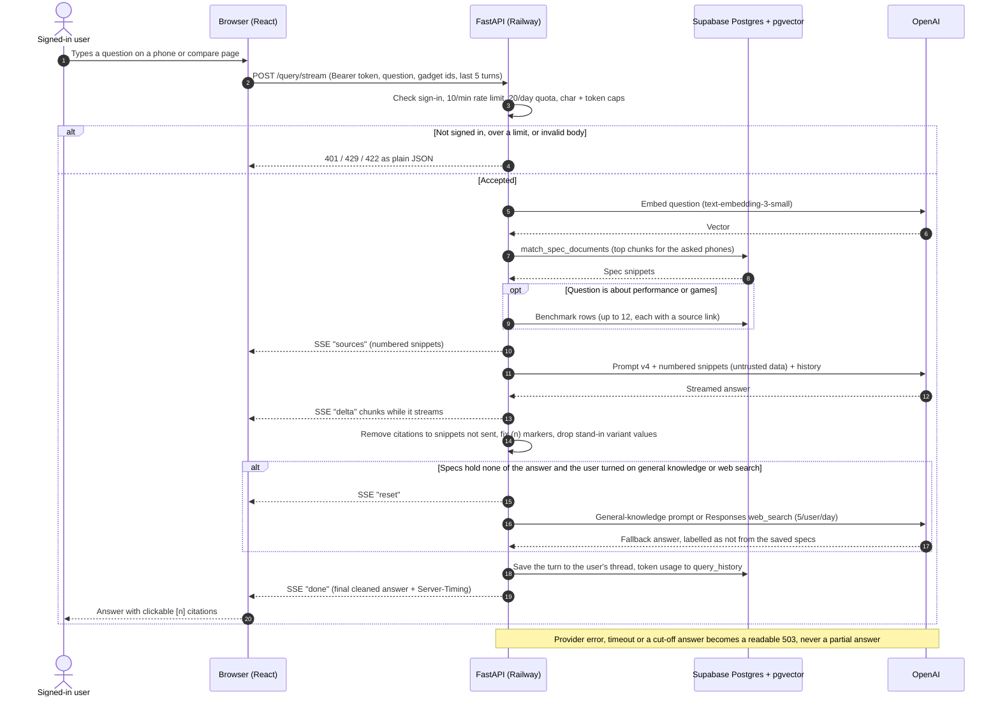
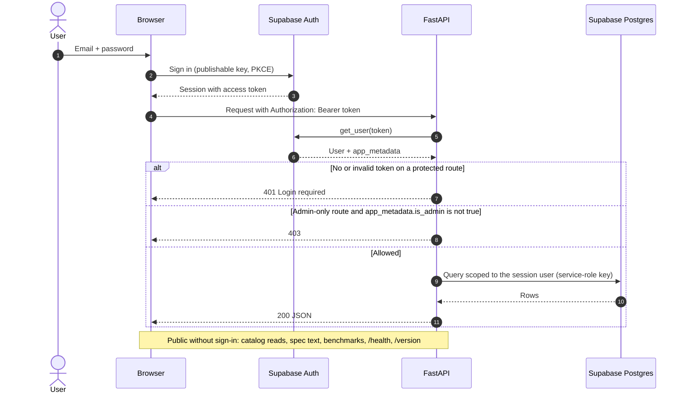
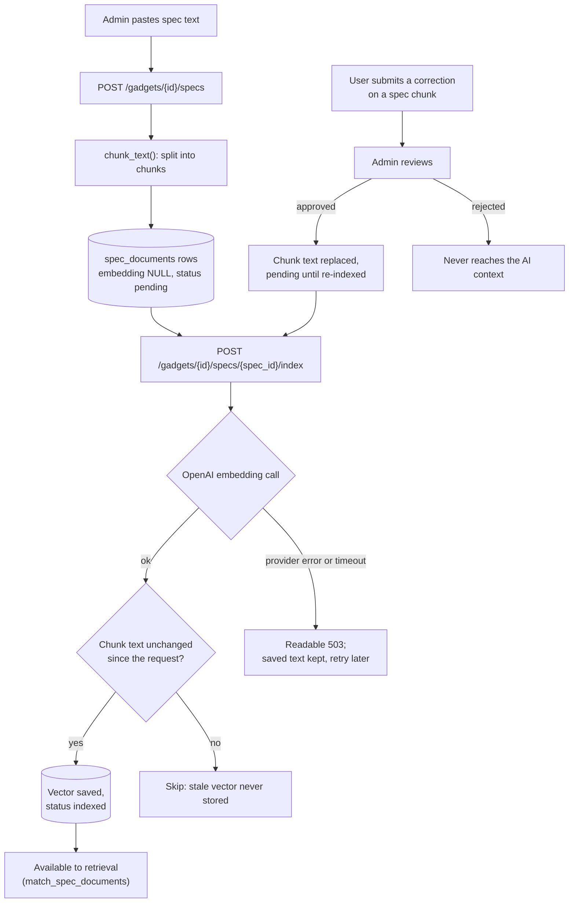
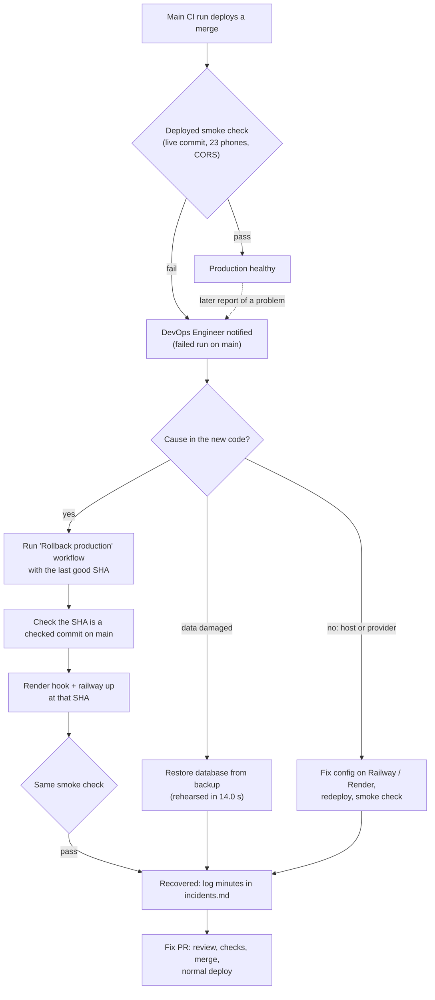

# TekaTech flow diagrams

Four request-level flows that complement the [system architecture](architecture.md), the [database ERD](database.md) and the [CI/CD pipeline](../PIPELINE.md). Each one is drawn from the code as it stands at the Demo Day freeze (27 Nov 2026).

## 1. Asking the AI a question (`POST /query/stream`)

Interactive version with source links for every participant: [AI answer: RAG, chat, General Knowledge and web search](diagrams/ai-answer.html) (Archify; download and open in a browser, source in [ai-answer.archify.json](diagrams/ai-answer.archify.json)).

One question about a phone, or a comparison of 2–5 phones. Facts come only from the saved snippets; the backend checks the answer before the browser keeps it.

## 2. Sign-in and authorization

The browser talks to Supabase only to sign in. Every data request goes through the backend, which decides access in route code (the service-role key bypasses RLS).

## 3. Saving and indexing a phone's specs (admin)

Saving never needs the AI provider, so an OpenAI outage cannot lose spec text.

## 4. Rollback and incident recovery

Used when a deploy passes CI but production misbehaves. Rehearsed in 1 min 35 s (31 Oct) and 1 min 17 s on Railway (12 Nov); see the [deploy runbook](deploy-runbook.md) and the [incident log](devops/incidents.md).

