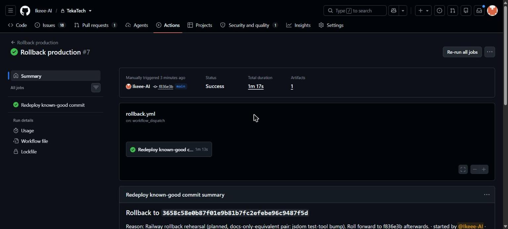
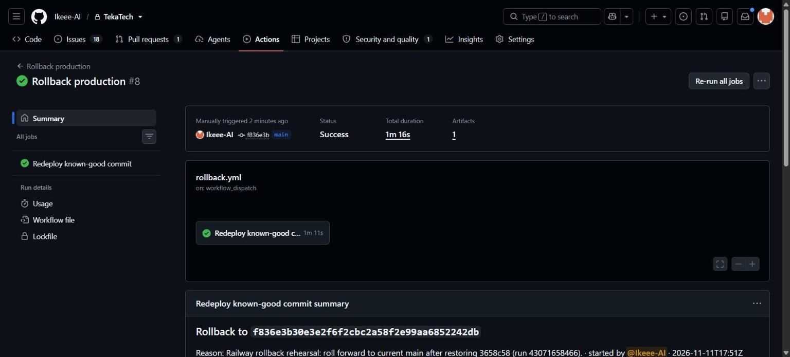
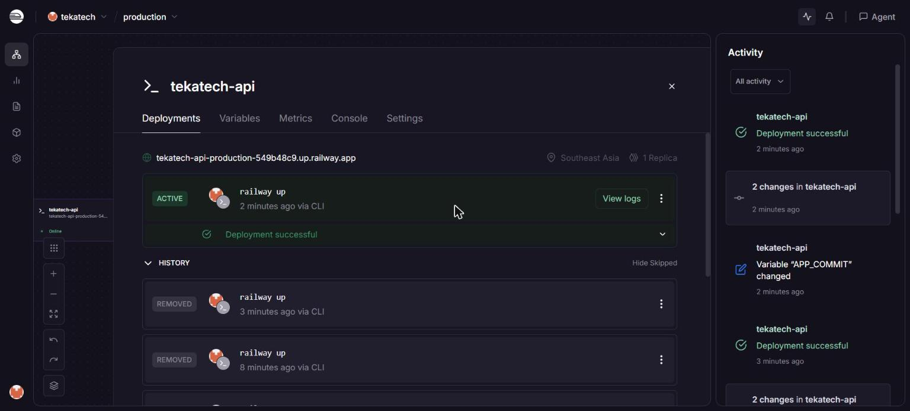

# Production rollback rehearsal on Railway: 12 November 2026

Owner: Ikeee-AI (DevOps, AI-assisted: yes). Why: the first rollback rehearsal on the new API host, which is part of "done" for the Railway move ([railway-migration-plan.md](../devops/railway-migration-plan.md) section 5). Runbook: [deploy-runbook.md](../deploy-runbook.md#rollback). Earlier rehearsal on Render: [31 Oct](rollback-rehearsal-2026-10-31.md).

**Method:** `.github/workflows/rollback.yml` (Actions → Rollback production), dispatched twice from `main` with `gh workflow run` by Ikeee-AI. The workflow refuses commits that are not on main, that lack green `Backend tests` / `Frontend lint and build` / `Database migrations` checks, or that predate the Railway API (no `backend/railway.json`). It then checks out the target SHA, deploys its backend to Railway (`railway up`, `APP_COMMIT=<sha>`), triggers the Render frontend hook (and the Render API fallback hook) for the same SHA, and runs `scripts/deployed_smoke.py` against production.

**Safety:** the rollback target `3658c58` (#241) and the current `main` `f836e3b` (#247) differ only in `frontend/package.json` and `frontend/package-lock.json` (the `jsdom` 30 → 31 test-tool bump), so users saw the same application throughout. No database change. No AI calls.

| Step | Target | Run | Started → finished (UTC; Manila = +8 h) | Recovery time | Smoke |
| --- | --- | --- | --- | --- | --- |
| Roll back | `3658c58e0b87f01e9b81b7fc2efebe96c9487f5d` | [43071658466](https://github.com/Ikeee-AI/TekaTech/actions/runs/43071658466) | 11 Nov 17:48:14 → 17:49:31 | **1 min 17 s** | passed: both hosts on `3658c58`, readiness passed (database 497.7 ms), CORS passed, 4 gadgets, waited 12.4 s for the new build |
| Roll forward | `f836e3b30e3e2f6f2cbc2a58f2e99aa6852242db` | [43071925255](https://github.com/Ikeee-AI/TekaTech/actions/runs/43071925255) | 11 Nov 17:49:56 → 17:51:12 | **1 min 16 s** | passed: both hosts on `f836e3b`, readiness passed (database 133.9 ms), CORS passed, 4 gadgets, waited 12.5 s |

Compared with Render on 31 Oct (1 min 35 s and 1 min 45 s), each step was about 20–30 s faster.

Afterwards the Railway API's `/version` and the frontend's `/version.json` both returned `f836e3b`, and `/health/ready` returned `{"status":"ok","database":"ok"}`. Production matched `main`, so no revert PR was needed.

## Screenshots

The commit `f836e3b` in the run header is the branch the workflow ran from (`main`). The restored commit is in the "Rollback to …" line.

1. Roll back to `3658c58`: success, 1 m 17 s.
   
2. Roll forward to `f836e3b`: success, 1 m 16 s.
   
3. Railway `tekatech-api` deployments: the roll-forward deploy is ACTIVE ("railway up … via CLI", Southeast Asia, 1 replica), and the rollback deploy appears in History.
   

Smoke reports: the `rollback-smoke-<sha>` artifacts of both runs (kept 30 days).

**Limits:** this rehearses the deploy mechanics on Railway, not a rollback across a breaking code or schema change. Recovery time here excludes detection time; a real incident adds it. Commits from before the Railway move can't be restored with `rollback.yml`; use Railway's dashboard redeploy for those (runbook).
